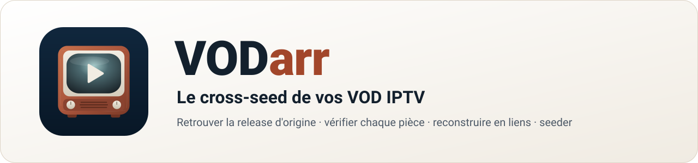
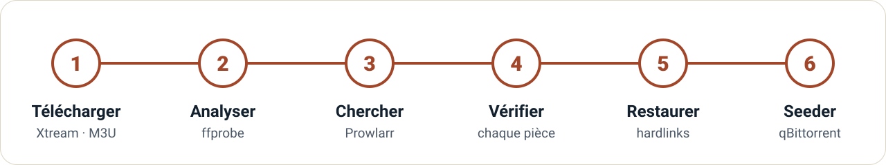

<div align="center">

<picture>
  <source media="(prefers-color-scheme: dark)" srcset="docs/assets/banner-fr-dark.svg">
  
</picture>

[](https://github.com/crocdeine/vodarr/actions/workflows/ci.yml)
[](https://github.com/crocdeine/vodarr/releases)
[](https://github.com/crocdeine/vodarr/pkgs/container/vodarr)

[](LICENSE)

[English](README.md) · **Français**

</div>

VODarr rejoint votre stack *arr. Il télécharge une saison ou un film depuis votre source VOD
IPTV (Xtream Codes ou M3U), retrouve la release P2P d'origine sur vos trackers via Prowlarr,
vérifie **pièce par pièce** que le contenu est identique, reconstitue la release par des
hardlinks sous ses noms d'origine, puis la met en seed dans qBittorrent : du **cross-seed à
partir de fichiers IPTV**.

> [!IMPORTANT]
> **Avertissement légal.** VODarr est un outil : il ne fournit, n'héberge ni ne distribue aucun
> contenu, et n'est livré avec aucune source, aucun tracker ni aucun compte. Vous êtes seul
> responsable de la légalité de la source IPTV à laquelle vous le connectez et de ce que vous
> téléchargez, conservez et partagez — de nombreux services IPTV n'ont pas les droits de diffuser
> ce qu'ils proposent. VODarr n'encourage pas le piratage. Utilisez-le uniquement avec des
> contenus auxquels vous avez légitimement accès, dans le respect du droit d'auteur de votre pays
> et des règles de vos trackers. VODarr n'est affilié ni à Prowlarr, ni à qBittorrent, ni à
> cross-seed, ni à TMDB, ni à aucun fournisseur IPTV, et n'est assorti d'aucune garantie (voir la
> [licence](LICENSE)).

<picture>
  <source media="(prefers-color-scheme: dark)" srcset="docs/assets/release-dark.webp">
  
</picture>

<sub>Captures en anglais ; l'interface existe aussi en français.</sub>

## Fonctionnalités

| | |
|---|---|
| 📺 **Parcourir vos VOD** | Catalogues Xtream Codes et M3U, affiches et fiches TMDB, une saison ou un film en un clic. |
| 🔍 **Retrouver la release d'origine** | Prowlarr interroge tous vos indexeurs : packs de saison, épisodes isolés, films, préfixes des fournisseurs retirés. |
| 🧩 **Vérifier chaque pièce** | Le `.torrent` de chaque candidat est comparé à vos fichiers ; seul un contenu identique part en seed. |
| 🔗 **Jamais de doublon** | Hardlinks (ou symlinks, reflinks) sous les noms d'origine, avec l'arborescence de cross-seed. Les téléchargements ne bougent pas. |
| 🌱 **Seed dans qBittorrent** | Ajout sur le dossier reconstitué, vérification, catégorie dédiée. Un épisode peut seeder sur plusieurs trackers. |
| 🛡️ **Auto-hébergé et prudent** | Un conteneur, aucun upload vers les trackers, secrets jamais affichés ni journalisés, interface en français et en anglais, thèmes sombre et clair. |

## Fonctionnement

<picture>
  <source media="(prefers-color-scheme: dark)" srcset="docs/assets/pipeline-fr-dark.svg">
  
</picture>

1. **Téléchargement** — une file globale, un fichier à la fois, avec reprise (`.part` + HTTP
   Range, 5 tentatives). Les fichiers arrivent dans `<téléchargements>/<source>/<titre>/Sxx/` et
   y restent.
2. **Analyse** — `ffprobe` lit le nom de release que certains fournisseurs laissent dans les
   étiquettes des pistes, et les données techniques affichées sur la page de la release
   (définition, codecs, HDR, langues, durée).
3. **Recherche** — Prowlarr cherche le titre sur vos indexeurs (ainsi que les titres original et
   anglais avec TMDB), puis retient les packs de la bonne saison, les épisodes isolés que vous
   avez, la bonne année pour un film, et les tailles à ±15 % des vôtres.
4. **Vérification** — chaque pièce de chaque candidat est comparée à vos fichiers. Par tracker
   et par portée, la taille la plus proche passe en premier et le premier identique arrête la
   recherche.
5. **Restauration** — des liens sous les noms d'origine dans `<dossier de liens>/<tracker>/<release>/`,
   comme [cross-seed](https://www.cross-seed.org/).
6. **Seed** — le torrent est ajouté à qBittorrent sur ce dossier avec une vérification forcée,
   dans sa propre catégorie. VODarr attend la fin de la vérification.

Une release se termine en **terminé**, **action requise** (certains fichiers diffèrent : vous
choisissez) ou **erreur** avec une raison traduite. Chaque étape peut être relancée.

<details>
<summary><b>Plus de captures</b></summary>
<br>

| L'Explorer avec la fiche TMDB | Une correspondance partielle qui attend votre choix |
|---|---|
|  |  |

</details>

## Compatibilité

| Composant | Pris en charge |
|---|---|
| Sources | API Xtream Codes, listes M3U (URL ou fichier) |
| Indexeurs | Prowlarr (API de recherche) |
| Client torrent | qBittorrent 4.6 → 5.2 (API WebUI v2, y compris sans authentification) |
| Métadonnées | TMDB (facultatif, votre propre clé gratuite) |
| Cross-seed | Même arborescence que cross-seed ; son `config.js` peut être importé (lu, jamais exécuté) |
| Image | `ghcr.io/crocdeine/vodarr` — `linux/amd64`, `linux/arm64` |

## Démarrage rapide

Prérequis : Docker, Prowlarr, qBittorrent, et un **volume `/data` unique partagé avec
qBittorrent** (les hardlinks ne fonctionnent qu'à l'intérieur d'un même système de fichiers).

```yaml
services:
  vodarr:
    image: ghcr.io/crocdeine/vodarr:latest
    container_name: vodarr
    restart: unless-stopped
    environment:
      PUID: "1000"                 # même utilisateur que qBittorrent
      PGID: "1000"
      TZ: Europe/Paris
      VODARR_ALLOWED_HOSTS: "localhost,vodarr,nas.local"   # chaque nom utilisé dans le navigateur
    volumes:
      - ./vodarr/config:/config
      - /chemin/vers/data:/data    # le MÊME dossier hôte que le /data de qBittorrent
    ports:
      - "8863:8863"
```

1. Démarrez : `docker compose up -d vodarr` (exemple complet :
   [`docker-compose.example.yml`](docker-compose.example.yml)).
2. Lisez le **code d'installation** dans le journal : `docker logs vodarr` →
   `First run: open VODarr and enter the setup code xxxx-xxxx-xxxx`.
3. Ouvrez `http://<hôte>:8863` et créez le compte administrateur avec ce code.
4. Dans **Réglages**, ajoutez votre source, Prowlarr, qBittorrent (chacun a un bouton
   *Tester*), le dossier de téléchargement (par exemple `/data/vod`) et le dossier de liens (par
   exemple `/data/cross-seed`). Si vous utilisez cross-seed, *Importer le config.js de
   cross-seed* reprend ses dossiers et son type de lien.

## Configuration

| Variable | Défaut | Rôle |
|---|---|---|
| `PUID` / `PGID` | `1000` | Utilisateur sous lequel tourne l'application (jamais root) |
| `TZ` | — | Fuseau horaire |
| `VODARR_ALLOWED_HOSTS` | `localhost`, nom et IP du conteneur | Noms d'hôte utilisés dans le navigateur, séparés par des virgules ; les autres reçoivent une erreur HTTP 421 (anti DNS-rebinding) |
| `VODARR_PORT` | `8863` | Port d'écoute |
| `VODARR_SETUP_TOKEN` | aléatoire | Code d'installation fixe au lieu de celui affiché dans le journal |
| `VODARR_DEV` | — | `1` active `/docs` (OpenAPI) |

Volumes : `/config` (base de données, cache du catalogue, `.torrent` de référence, fichiers M3U
dans `/config/playlists`) et `/data` (vos médias, partagés avec qBittorrent).

**Réglages utiles**

- **TMDB (facultatif)** — votre propre clé gratuite sur [themoviedb.org](https://www.themoviedb.org/settings/api)
  (clé d'API v3 ou jeton d'accès en lecture v4) ajoute synopsis, affiche, genres, note et
  distribution. Les requêtes à l'API TMDB partent de VODarr ; les affiches sont chargées par
  votre navigateur depuis `image.tmdb.org`.
- **Chemin vu par qBittorrent** — si qBittorrent monte le même dossier sous un autre chemin,
  renseignez *Racine des données (VODarr)* et *Même racine vue par qBittorrent* (par exemple
  `/data` → `/downloads`).
- **Type de lien** — `hardlink` (défaut), `symlink` ou `reflink` (btrfs/xfs). Les hardlinks
  exigent que les téléchargements et le dossier de liens soient sur le même volume ; VODarr le
  vérifie à l'enregistrement.
- **Disposition à plat** — `<dossier de liens>/<release>` au lieu de
  `<dossier de liens>/<tracker>/<release>`.
- **Catégorie** — `cross-seed-link` par défaut.

## Comportements automatiques

VODarr agit pour vous de ces façons ; chacune est délibérée.

- **Téléchargement de `.torrent` depuis vos trackers.** Pour vérifier un candidat, VODarr
  télécharge son `.torrent` via Prowlarr — seulement les candidats filtrés, et il s'arrête au
  premier identique par tracker et par portée. Sur certains trackers privés, cela compte comme
  un *snatch* : vérifiez d'abord leurs règles de hit-and-run ; *Réglages › Prowlarr* permet de plafonner les vérifications par tracker. Les `.torrent` de référence restent
  dans `/config/torrents` (ils contiennent votre passkey) et ne sont jamais servis par l'API.
- **Les fichiers téléchargés ne bougent jamais.** Ils ne sont ni déplacés, ni renommés, ni
  copiés ; la release reconstituée est faite de liens qui pointent vers eux.
- **Retrait sur place du bourrage NUL — la seule modification jamais apportée à un fichier
  téléchargé.** Certains fournisseurs IPTV ajoutent quelques octets NUL à la fin des fichiers.
  Un hardlink *est* le même fichier : pour qu'il corresponde à la release d'origine, VODarr
  ramène le fichier téléchargé à sa longueur d'origine. Seuls des octets NUL sont retirés, et
  seulement après avoir vérifié qu'il n'y a rien d'autre (sinon le fichier est signalé
  *différent* et laissé intact). La vidéo est inchangée au bit près ; la seule autre solution
  serait une copie, donc un doublon sur le disque.
- **Tolérance de taille de ±15 %.** Les résultats trop éloignés de votre taille sont listés mais
  pas vérifiés ; dans la tolérance, la vérification des pièces décide.
- **Annexes complétées par qBittorrent.** Quand il ne manque que de petits fichiers (`.nfo`,
  samples, fichiers non vidéo de moins de 1 Mio), la correspondance est *identique, annexes à
  compléter* et qBittorrent les télécharge lui-même.
- **Les correspondances partielles attendent votre choix.** Si une vidéo diffère, la release
  affiche *action requise* avec le détail fichier par fichier et un bouton **Compléter depuis
  \<tracker\>** : seuls les fichiers identiques sont liés, qBittorrent télécharge le reste dans
  le dossier de liens.
- **Supprimer une release** retire ce que VODarr a créé : ses torrents dans qBittorrent (avec les
  liens et ce que qBittorrent a complété), les liens et l'enregistrement. Les fichiers
  téléchargés ne sont supprimés que si vous cochez la case. Un torrent déjà présent dans
  qBittorrent avant VODarr n'est jamais retiré.

## Dépannage

<details>
<summary><b>Le navigateur affiche <code>http.host_not_allowed</code> (HTTP 421)</b></summary>

Le nom dans la barre d'adresse n'est pas dans `VODARR_ALLOWED_HOSTS`. Ajoutez chaque nom et
adresse que vous utilisez — nom sur le réseau local, IP, nom Tailscale ou d'un autre VPN,
domaine du reverse proxy — puis recréez le conteneur. Un reverse proxy doit conserver l'en-tête
`Host`.
</details>

<details>
<summary><b>L'enregistrement échoue : « Téléchargements et dossier de liens doivent être sur le même volume »</b></summary>

Un hardlink ne peut pas traverser deux systèmes de fichiers. Montez un même dossier parent en
`/data` dans VODarr et dans qBittorrent et placez-y les dossiers de téléchargement et de liens,
ou choisissez `symlink`.
</details>

<details>
<summary><b>Des seeds disparaissent de qBittorrent</b></summary>

Un outil de nettoyage (Cleanuparr, qbit_manage…) peut retirer les torrents qu'il ne connaît
pas. Excluez la catégorie de VODarr (`cross-seed-link` par défaut).
</details>

<details>
<summary><b>Docker Desktop sur macOS : erreurs de base de données sur <code>/config</code></b></summary>

VODarr utilise le journal de rollback de SQLite, qui fonctionne sur les dossiers partagés avec
la machine virtuelle de Docker. Si `disk I/O error` apparaît malgré tout, placez `/config` sur un
disque local plutôt que sur un partage réseau.
</details>

<details>
<summary><b>Aucune release n'est jamais trouvée</b></summary>

Ouvrez l'onglet *Identification* de la release : il liste les résultats trouvés et les candidats
vérifiés. Ajoutez une clé TMDB pour que les titres original et anglais soient aussi cherchés,
et vérifiez dans Prowlarr que vos indexeurs renvoient des résultats pour ce titre.
</details>

## Sécurité

- **Compte administrateur** créé au premier lancement avec le code à usage unique du journal :
  personne d'autre sur votre réseau ne peut s'approprier une instance neuve. Mots de passe :
  scrypt, 12 caractères minimum.
- **Sessions** dans un cookie `HttpOnly`, `SameSite=Strict`, 30 jours glissants. **Clé d'API**
  pour les scripts (en-tête `X-Api-Key`) : masquée dans les Réglages, affichée après saisie du
  mot de passe administrateur.
- **Force brute :** 5 échecs en 5 minutes bloquent cette adresse 5 minutes ; 50 échecs toutes
  adresses confondues bloquent tout le monde. Derrière un reverse proxy, tous les clients
  partagent l'adresse du proxy.
- **Aucune exemption pour le réseau local**, une liste d'hôtes `Host` autorisés, une vérification
  d'origine sur chaque modification, une Content Security Policy stricte, requêtes limitées à
  1 Mio.
- **Les secrets** (mots de passe des sources, URL M3U, clés d'API, mot de passe qBittorrent) sont
  stockés dans `/config/vodarr.db` (mode 600, dossier 700), jamais renvoyés au navigateur
  (affichés `••••`) et jamais écrits dans le journal.
- **Les affiches** sont chargées par votre navigateur directement depuis les serveurs d'images du
  fournisseur ou de TMDB (qui voient donc votre adresse IP), comme dans toute application IPTV.
- **Pas de TLS** dans le conteneur : pour un accès à distance, passez par votre reverse proxy ou
  votre VPN.

## Développement

```bash
python3.12 -m venv .venv && . .venv/bin/activate
pip install -e '.[dev]'
pytest -q                                   # ~700 tests, sans réseau
ruff check . && ruff format --check .
python -m tests.fakes.serve                 # faux Xtream, Prowlarr, qBittorrent, TMDB (données synthétiques)
VODARR_CONFIG=.dev-config VODARR_ALLOWED_HOSTS=localhost \
  uvicorn vodarr.app:create_app --factory --port 8863
```

Décisions de conception dans [`docs/adr/`](docs/adr/).
L'interface est en HTML, CSS et modules JavaScript, sans étape de build. Les captures de ce README proviennent des faux services : titres,
trackers et fichiers y sont tous inventés.

Les tickets et pull requests sont bienvenus. Gardez des données de test synthétiques et ne
collez jamais de vrais identifiants, noms de trackers ou passkeys.

## Licence

[MIT](LICENSE). VODarr n'est affilié ni à Prowlarr, ni à qBittorrent, ni à cross-seed, ni à
TMDB, ni à aucun fournisseur IPTV. Utilisez-le avec des contenus auxquels vous avez légitimement
accès, et respectez les règles de vos trackers.
