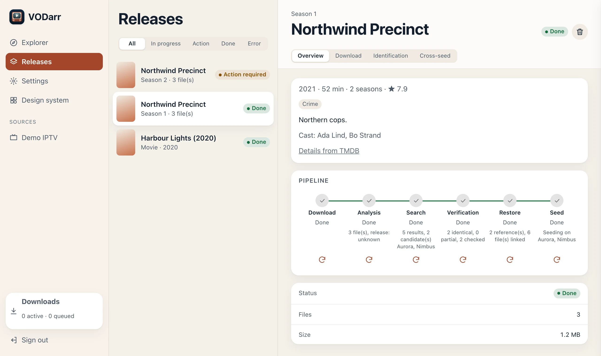
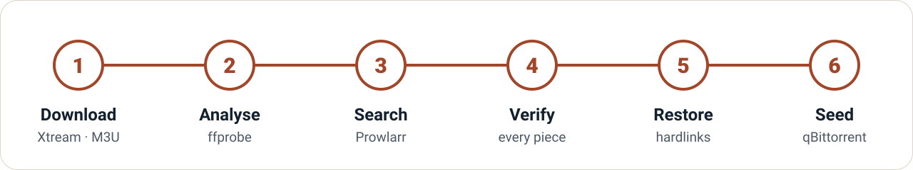
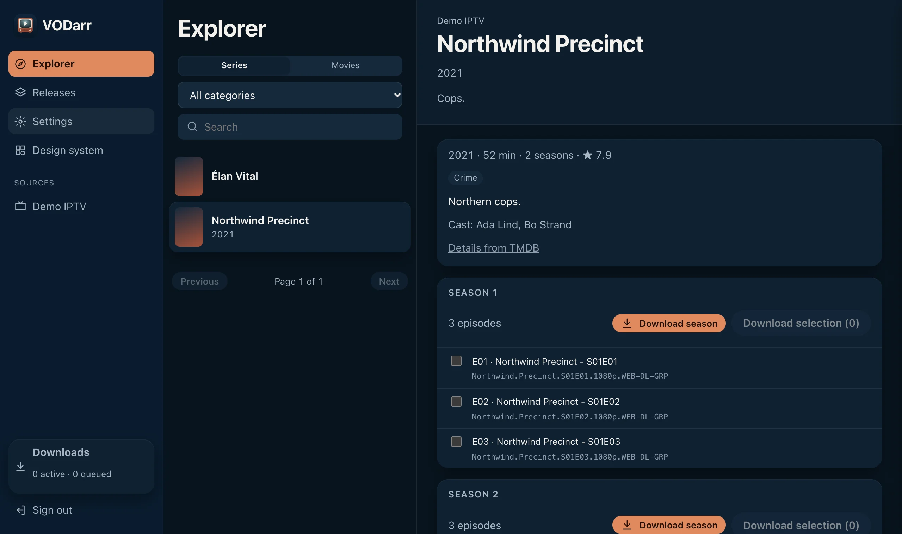
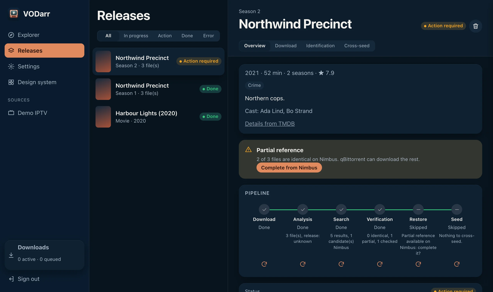

<div align="center">

<picture>
  <source media="(prefers-color-scheme: dark)" srcset="docs/assets/banner-en-dark.svg">
  
</picture>

[](https://github.com/crocdeine/vodarr/actions/workflows/ci.yml)
[](https://github.com/crocdeine/vodarr/releases)
[](https://github.com/crocdeine/vodarr/pkgs/container/vodarr)

[](LICENSE)

**English** · [Français](README.fr.md)

</div>

VODarr joins your *arr stack. It downloads a season or a movie from your IPTV VOD source
(Xtream Codes or M3U), finds the original P2P release on your trackers through Prowlarr,
checks **piece by piece** that the content is identical, rebuilds the release with hardlinks
under its original names, and seeds it in qBittorrent: **cross-seeding from IPTV files**.

> [!IMPORTANT]
> **Legal disclaimer.** VODarr is a tool: it provides, hosts and distributes no content and
> ships with no source, tracker or account. You alone are responsible for the legality of the
> IPTV source you connect to and of what you download, keep and share — many IPTV services are
> not licensed to distribute what they offer. VODarr does not condone piracy. Use it only with
> content you are entitled to access, and respect copyright law where you live and the rules of
> your trackers. VODarr is not affiliated with Prowlarr, qBittorrent, cross-seed, TMDB or any
> IPTV provider, and comes with no warranty (see the [licence](LICENSE)).

<picture>
  <source media="(prefers-color-scheme: dark)" srcset="docs/assets/release-dark.webp">
  
</picture>

## Features

| | |
|---|---|
| 📺 **Browse your VOD** | Xtream Codes and M3U catalogues, posters and TMDB details, a season or a movie in one click. |
| 🔍 **Find the original release** | Prowlarr searches all your indexers: season packs, single episodes, movies, provider prefixes stripped. |
| 🧩 **Verify every piece** | Each candidate `.torrent` is hashed against your files; only identical content is seeded. |
| 🔗 **Never duplicate** | Hardlinks (or symlinks, reflinks) under the original names, in the cross-seed layout. Downloads never move. |
| 🌱 **Seed in qBittorrent** | Added on the rebuilt folder, checked, in its own category. One episode can seed on several trackers. |
| 🛡️ **Self-hosted and careful** | One container, no upload to trackers, secrets never shown or logged, English and French UI, dark and light themes. |

## How it works

<picture>
  <source media="(prefers-color-scheme: dark)" srcset="docs/assets/pipeline-en-dark.svg">
  
</picture>

1. **Download** — one global queue, one file at a time, resumable (`.part` + HTTP Range,
   5 attempts). Files land in `<downloads>/<source>/<title>/Sxx/` and stay there.
2. **Analyse** — `ffprobe` reads the release name some providers leave in the track tags and the
   technical facts shown on the release page (resolution, codecs, HDR, languages, duration).
3. **Search** — Prowlarr searches your indexers for the title (and its original and English
   titles with TMDB), then keeps season packs of the right season, isolated episodes you have,
   the right year for a movie, and sizes within ±15 % of yours.
4. **Verify** — every piece of each candidate is hashed against your files. Per tracker and
   scope, the closest size is tried first and the first identical one stops the search.
5. **Restore** — links under the original names in `<link dir>/<tracker>/<release>/`, like
   [cross-seed](https://www.cross-seed.org/).
6. **Seed** — the torrent is added to qBittorrent on that folder with a forced check, in its own
   category. VODarr waits for the check to finish.

A release ends as **done**, **action required** (some files differ: you choose) or **error**
with a translated reason. Any stage can be retried.

<details>
<summary><b>More screenshots</b></summary>
<br>

| Explorer with TMDB details | A partial match waiting for you |
|---|---|
|  |  |

</details>

## Compatibility

| Component | Supported |
|---|---|
| Sources | Xtream Codes API, M3U playlists (URL or file) |
| Indexers | Prowlarr (search API) |
| Torrent client | qBittorrent 4.6 → 5.2 (WebUI API v2, including authentication bypass) |
| Metadata | TMDB (optional, your own free key) |
| Cross-seed | Same folder layout as cross-seed; its `config.js` can be imported (read, never executed) |
| Image | `ghcr.io/crocdeine/vodarr` — `linux/amd64`, `linux/arm64` |

## Quick start

Requirements: Docker, Prowlarr, qBittorrent, and a **single `/data` volume shared with
qBittorrent** (hardlinks only work inside one filesystem).

```yaml
services:
  vodarr:
    image: ghcr.io/crocdeine/vodarr:latest
    container_name: vodarr
    restart: unless-stopped
    environment:
      PUID: "1000"                 # same user as qBittorrent
      PGID: "1000"
      TZ: Europe/Paris
      VODARR_ALLOWED_HOSTS: "localhost,vodarr,nas.local"   # every name you use in the browser
    volumes:
      - ./vodarr/config:/config
      - /path/to/data:/data        # the SAME host folder qBittorrent mounts as /data
    ports:
      - "8863:8863"
```

1. Start it: `docker compose up -d vodarr` (full example:
   [`docker-compose.example.yml`](docker-compose.example.yml)).
2. Read the **setup code** in the log: `docker logs vodarr` →
   `First run: open VODarr and enter the setup code xxxx-xxxx-xxxx`.
3. Open `http://<host>:8863` and create the admin account with that code.
4. In **Settings**, add your source, Prowlarr, qBittorrent (each has a *Test* button), the
   downloads folder (e.g. `/data/vod`) and the link folder (e.g. `/data/cross-seed`). If you use
   cross-seed, *Import cross-seed config.js* fills in its folders and link type.

## Configuration

| Variable | Default | Purpose |
|---|---|---|
| `PUID` / `PGID` | `1000` | User the app runs as (never root) |
| `TZ` | — | Time zone |
| `VODARR_ALLOWED_HOSTS` | `localhost`, container name and IP | Comma-separated host names you use in the browser; others get HTTP 421 (anti DNS-rebinding) |
| `VODARR_PORT` | `8863` | Listening port |
| `VODARR_SETUP_TOKEN` | random | Fixed setup code instead of the one printed in the log |
| `VODARR_DEV` | — | `1` enables `/docs` (OpenAPI) |

Volumes: `/config` (database, catalogue cache, reference `.torrent` files, M3U files under
`/config/playlists`) and `/data` (your media, shared with qBittorrent).

**Settings worth knowing**

- **TMDB (optional)** — your own free key from [themoviedb.org](https://www.themoviedb.org/settings/api)
  (v3 API key or v4 read access token) adds synopsis, poster, genres, rating and cast. Requests
  to the TMDB API come from VODarr; posters are loaded by your browser from `image.tmdb.org`.
- **Path seen by qBittorrent** — if qBittorrent mounts the same folder under another path, set
  *Data root (VODarr)* and *Same root as seen by qBittorrent* (e.g. `/data` → `/downloads`).
- **Link type** — `hardlink` (default), `symlink` or `reflink` (btrfs/xfs). Hardlinks need the
  downloads and the link folder on the same volume; VODarr checks it when you save.
- **Flat layout** — `<link dir>/<release>` instead of `<link dir>/<tracker>/<release>`.
- **Category** — `cross-seed-link` by default.

## Automatic behaviours

VODarr acts on your behalf in these ways; each one is deliberate.

- **`.torrent` downloads from your trackers.** To verify a candidate, VODarr downloads its
  `.torrent` through Prowlarr — only filtered candidates, stopping at the first identical one
  per tracker and scope. On some private trackers this counts as a *snatch*: check their
  hit-and-run rules first; *Settings › Prowlarr* can cap the checks per tracker. Reference `.torrent` files stay in `/config/torrents` (they contain
  your passkey) and are never served by the API.
- **Daily new searches.** A release without a match is searched again once a day for 30 days
  (*Settings › Prowlarr*, 0 = never), as releases often reach the trackers after the provider.
  Only new results are checked; a `.torrent` is never downloaded twice.
- **Downloaded files never move.** They are not moved, renamed or copied; the rebuilt release
  is made of links pointing to them.
- **In-place NUL padding removal — the only change ever made to a downloaded file.** Some IPTV
  providers append a few NUL bytes to the end of files. A hardlink *is* the same file, so for
  it to match the original release VODarr truncates the downloaded file to its original length.
  Only NUL bytes are removed, and only after checking there is nothing else (otherwise the file
  is reported as *different* and left untouched). The video is bit-for-bit unchanged; the only
  alternative would be a duplicate copy on disk.
- **±15 % size tolerance.** Results far from your size are listed but not verified; inside it,
  the piece check decides.
- **Annexes completed by qBittorrent.** When only small extras are missing (`.nfo`, samples,
  non-video files under 1 MiB), the match is *identical, annexes to complete* and qBittorrent
  downloads them itself.
- **Partial matches wait for you.** If a video differs, the release shows *action required*
  with a file-by-file report and a **Complete from \<tracker\>** button: only identical files
  are linked, qBittorrent downloads the rest into the link folder.
- **Deleting a release** removes what VODarr created: its torrents in qBittorrent (with the
  links and what qBittorrent completed), the links and the record. Downloaded files are deleted
  only if you tick the box. A torrent that was already in qBittorrent before VODarr is never
  removed.

## Troubleshooting

<details>
<summary><b>The browser shows <code>http.host_not_allowed</code> (HTTP 421)</b></summary>

The name in the address bar is not in `VODARR_ALLOWED_HOSTS`. Add every name and address you
use — LAN name, IP, Tailscale or other VPN name, reverse-proxy domain — then recreate the
container. A reverse proxy must keep the `Host` header.
</details>

<details>
<summary><b>Saving settings fails: "Downloads and the link folder must be on the same volume"</b></summary>

Hardlinks cannot cross filesystems. Mount one parent folder as `/data` in both VODarr and
qBittorrent and put the downloads and link folders inside it, or choose `symlink`.
</details>

<details>
<summary><b>Seeds disappear from qBittorrent</b></summary>

A cleaning tool (Cleanuparr, qbit_manage…) may remove torrents it does not know. Exclude the
VODarr category (`cross-seed-link` by default).
</details>

<details>
<summary><b>Docker Desktop on macOS: database errors on <code>/config</code></b></summary>

VODarr uses SQLite's rollback journal, which works on folders shared with the Docker VM. If you
still see `disk I/O error`, keep `/config` on a local disk rather than a network share.
</details>

<details>
<summary><b>No release is ever found</b></summary>

Open the release's *Identification* tab: it lists the results found and the candidates checked. Add a
TMDB key so original and English titles are searched too, and make sure your indexers return
results for the title in Prowlarr itself.
</details>

## Security

- **Admin account** created at first run with the one-time code from the log, so no one else on
  your network can claim a fresh instance. Passwords: scrypt, 12 characters minimum.
- **Sessions** in an `HttpOnly`, `SameSite=Strict` cookie, 30 days, sliding. **API key** for
  scripts (`X-Api-Key` header): masked in Settings, shown after typing the admin password.
- **Brute force:** 5 failures in 5 minutes lock that address for 5 minutes; 50 failures from all
  addresses lock everyone. Behind a reverse proxy every client shares the proxy's address.
- **No local-network exemption**, a `Host` allowlist, same-origin checks on every change, a
  strict Content Security Policy, 1 MiB request limit.
- **Secrets** (source passwords, M3U URL, API keys, qBittorrent password) are stored in
  `/config/vodarr.db` (mode 600, folder 700), never sent back to the browser (shown as `••••`)
  and never written to the logs.
- **Posters** are loaded by your browser straight from the provider's or TMDB's image hosts
  (so they see your IP address), like in any IPTV app.
- **No TLS** inside the container: for remote access, use your reverse proxy or VPN.

## Development

```bash
python3.12 -m venv .venv && . .venv/bin/activate
pip install -e '.[dev]'
pytest -q                                   # ~700 tests, no network
ruff check . && ruff format --check .
python -m tests.fakes.serve                 # fake Xtream, Prowlarr, qBittorrent, TMDB (synthetic data)
VODARR_CONFIG=.dev-config VODARR_ALLOWED_HOSTS=localhost \
  uvicorn vodarr.app:create_app --factory --port 8863
```

Design decisions in [`docs/adr/`](docs/adr/) (in
French). The interface is plain HTML, CSS and JavaScript modules with no build step. Screenshots in this README come from the fake services:
every title, tracker and file in them is made up.

Issues and pull requests are welcome. Please keep test data synthetic and never paste real
credentials, tracker names or passkeys.

## Licence

[MIT](LICENSE). VODarr is not affiliated with Prowlarr, qBittorrent, cross-seed, TMDB or any
IPTV provider. Use it with content you are entitled to access, and respect your trackers' rules.
